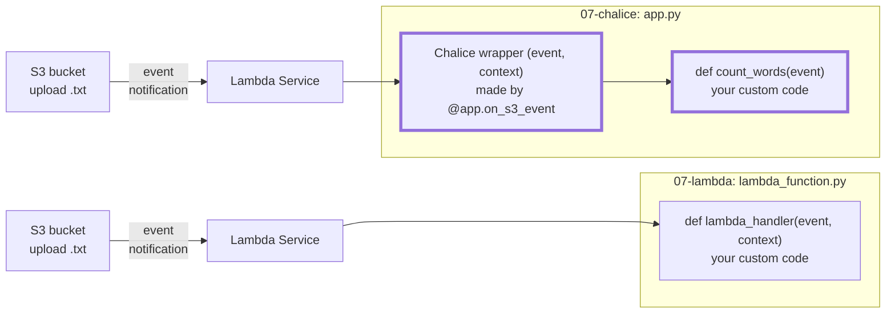

# A Lambda function with Chalice

Instructor demo, after [07-lambda](../../demos/07-lambda/README.md) and before Lab 07 Part 2: the same word-count function, now created from code with Chalice instead of by hand in the console. Concepts: [class/07-lambda](../07-lambda/README.md).

## Learning objectives

Understand how to write a Chalice app that deploys a Lambda function:

- What the components of a Chalice app are: `app.py`, `requirements.txt`, `.chalice/config.json`, and the optional `chalicelib/` directory
- How to build a Chalice app: list the packages, configure the deployment, write the handler
- How to deploy a Chalice app
- How to monitor a Chalice app: trigger it and read its log

> [!IMPORTANT]
> Use a separate bucket, not `public-mst3k`. A second `.txt` trigger on the Lab 06 bucket makes `chalice deploy` fail in Lab 07.

Every Chalice app is built in the same six steps, whatever triggers it:

1. **Create the project:** `chalice new-project` generates the folder with `app.py`, `requirements.txt`, and `.chalice/config.json`.
2. **Add your own modules (optional):** code that does not belong in `app.py` goes into `chalicelib/`, the only folder Chalice uploads besides `app.py`. Not needed here: the code from 07-lambda fits into `app.py`.
3. **List the packages:** Lambda's Python runtime includes the Python standard library and the AWS SDK for Python (`boto3` and `botocore`, with their dependencies). Every other package your function imports, for example `pymongo` or `numpy`, must be listed in `requirements.txt`. `chalice deploy` installs these packages into the deployment package, which it uploads to AWS, so they are already in place when the function runs.
4. **Configure the deployment:** the IAM role, memory, and timeout go into `.chalice/config.json`. These are the settings of the **Configuration** tab in the AWS Console: **Permissions** (execution role) and **General configuration** (memory, timeout).
5. **Write the handler:** in `app.py`, a function with a decorator that says which event runs it.
6. **Deploy:** `chalice deploy` creates the function and its trigger in AWS.

## 0. Setup

1. On the **Learner Lab page**, click **Start Lab** and wait for the green **AWS** icon. See [Start the AWS Academy Learner Lab (class/06-s3)](../06-s3/README.md#start-the-aws-academy-learner-lab).
2. Click **AWS Details** → **AWS CLI** → **Show**. Copy the block into `~/.aws/credentials` on your computer (credentials change with every lab session). Check with `aws sts get-caller-identity`.
3. On your computer, open a terminal and run these commands:

   ```bash
   mkdir -p ~/ds2022-fall2026/chalice-demo
   cd ~/ds2022-fall2026/chalice-demo
   uv init --bare --python 3.13 --pin-python
   uv add --dev chalice boto3
   ```

   Line 3 initializes a new Python project with `uv`:

   - `--bare` creates only `pyproject.toml`. Without it, `uv` also creates a Git repository, a `README.md`, and sample code, which this demo does not need.
   - `--python 3.13 --pin-python` pins the Python version to 3.13 (in `.python-version`). We know that version is available for AWS Lambda (referred to as **Runtime** in the AWS Console), and Chalice picks the Lambda runtime from your local Python version.

   Line 4 adds Chalice and `boto3`:

   - `app.py` imports `boto3`, so it needs `boto3` on your computer before it can be deployed to AWS.
   - `--dev` lists them as development tools (under `[dependency-groups]` in `pyproject.toml`): packages you use on your computer, not part of the deployed app.
   - Lambda gets its packages from `requirements.txt` (Step 3), not from `pyproject.toml`.

## 1. Create a bucket for the demo

```bash
aws s3 mb s3://demo-mst3k
```

## 2. Create the project

```bash
uv run chalice new-project textapp
cd textapp
ls -la
```

Chalice creates:

- `.chalice/config.json`: the deployment settings. We will update the JSON file in Step 4.
- `.gitignore`: keeps Chalice's build files out of Git
- `app.py`: the Lambda function; right now a sample web endpoint. We will update the `app.py` script in Step 5.
- `requirements.txt`: the packages Chalice installs into the Lambda package; empty

**All following steps run in `textapp/`.**

## 3. List the packages

The code imports only `boto3` (AWS SDK), which is included in Lambda's Python runtime. `requirements.txt` stays empty.

## 4. Configure the deployment

The Learner Lab does not let Chalice create an IAM role, so the function uses `LabRole`, like in the console. Look up your 12-digit account ID:

```bash
aws sts get-caller-identity --query Account --output text
```

Open `.chalice/config.json`, the file `chalice new-project` created, and add two lines to the `dev` stage, with your account ID instead of `123456789012` (mind the comma after `"api"`):

```json
{
  "version": "2.0",
  "app_name": "textapp",
  "stages": {
    "dev": {
      "api_gateway_stage": "api",
      "manage_iam_role": false,
      "iam_role_arn": "arn:aws:iam::123456789012:role/LabRole"
    }
  }
}
```

- `"manage_iam_role": false` stops Chalice from creating a role.
- `"iam_role_arn"` names `LabRole` in your account.
- `"api_gateway_stage"` can be ignored. It is only used by web endpoints; we'll get to that in Lab 10.

Memory and timeout are not in `config.json`, so Chalice uses its built-in defaults: 128 MB and 60 s (a function created in the console gets 3 s). To change them, add `"lambda_memory_size"` (MB) and `"lambda_timeout"` (seconds) to the `dev` stage.

## 5. Write the handler

Open `app.py`, delete everything in it (the sample web endpoint), and paste this. Update the bucket name in `BUCKET` to your bucket from Step 1.

```python
import boto3
from chalice import Chalice

# Update the bucket name to your bucket
BUCKET = "demo-mst3k"

app = Chalice(app_name="textapp")
s3 = boto3.client("s3")


@app.on_s3_event(bucket=BUCKET, events=["s3:ObjectCreated:*"], suffix=".txt")
def count_words(event):
    """Count the words in the uploaded file and log the result."""
    # Chalice hands over the bucket and the decoded key: no Records loop, no unquote_plus
    text = s3.get_object(Bucket=event.bucket, Key=event.key)["Body"].read().decode("utf-8", errors="replace")
    # print output goes to CloudWatch Logs
    print(f"{event.key}: {len(text.split())} words")
```

Compare with `lambda_handler` in [lambda_function.py](../../demos/07-lambda/lambda_function.py): there, `event` is the raw dict, so the code loops over `event["Records"]` and decodes the key with `unquote_plus`. Here, `event` is an `S3Event` object provided by Chalice that already holds `event.bucket` and the decoded `event.key`. This makes it even easier for us.

> [!NOTE]
> We don't need a shebang (`#!/usr/bin/env python3`) at the top of `app.py` because it is not run as a standalone script. AWS Lambda imports `app.py` as a module, like a package. `chalice deploy` does the same on your computer to find the handlers. That is why we installed `boto3` locally during the setup.

| Part | What it does |
| --- | --- |
| `@app.on_s3_event(...)` | the S3 trigger: bucket, event type, suffix, as in 07-lambda, Step 5 |
| `def count_words(event)` | the Lambda function, deployed as `textapp-dev-count_words` (confirm in AWS console) |
| `event.bucket`, `event.key` | the bucket and the decoded object key, read by Chalice from the raw event dict (the raw dict is still in `event.to_dict()`) |

**No `context` parameter.** `lambda_handler(event, context)` takes two arguments; `count_words(event)` takes only one. Lambda still passes both, but to a wrapper that Chalice puts in front of your function:



The **Lambda Service** receives the event, looks up the function's handler setting, and calls that handler in the **Lambda function**, your deployed code. Bold outline: parts of the Chalice app. All other boxes are the standard flow from an S3 event notification to a Lambda handler, the same in both rows.

**How the S3 event reaches `count_words`.** Chalice does not listen for events while the app runs. It does its work at deploy time, and Lambda does the rest:

1. **The decorator registers the function.** When Python imports `app.py`, `@app.on_s3_event(...)` records the trigger (bucket, events, suffix) in `app` and replaces `count_words` with a wrapper object that accepts `(event, context)`.
2. **`chalice deploy` reads the registrations.** It imports `app.py` on your computer, finds the trigger, creates the Lambda function with the handler `app.count_words` (module `app`, name `count_words`), lets S3 invoke it, and adds the event notification to the bucket: the same pieces you clicked together in 07-lambda.
3. **S3 invokes Lambda.** On an upload, S3 sends the event straight to the Lambda function; Chalice is not involved.
4. **Lambda calls the handler.** It imports `app.py` and calls `app.count_words(event, context)`, which is the wrapper. The wrapper builds an `S3Event` object from the event dict and the context, and calls your function with only that object.

If you need the context (for example the remaining run time), it is in `event.context`. The handler name is in the console: **Lambda** → `textapp-dev-count_words` → **Code** → **Runtime settings** → **Handler**.

## 6. Deploy

```bash
uv run chalice deploy
```

Chalice packages the code, creates `textapp-dev-count_words`, and adds the trigger to the bucket.

Go to the AWS Console, open the **Lambda** service dashboard, and locate the new function `textapp-dev-count_words` under **Functions**. Review:

- **Code** tab: your `app.py`, next to the `chalice` package that Chalice uploads with it. **Runtime settings** → **Handler** shows `app.count_words`.
- **Triggers**: **Function overview** (or **Configuration** → **Triggers**) shows **S3** with bucket `demo-mst3k` and suffix `.txt`.
- **Configuration** tab: **General configuration** shows 128 MB of memory and a timeout of 1 min; **Permissions** shows the execution role `LabRole`.

The other half of the trigger is on the bucket: **S3** → `demo-mst3k` → **Properties** → **Event notifications**.

After a change to `app.py`, run `uv run chalice deploy` again: it updates the function in place.

## 7. Upload a file and check the log

```bash
curl -sSo pg74.txt https://www.gutenberg.org/cache/epub/74/pg74.txt
aws s3 cp pg74.txt s3://demo-mst3k/
uv run chalice logs -n count_words
```

Expected:

```text
... pg74.txt: 73849 words
```

No log after a minute: upload again (the first trigger on a bucket can take a few minutes). The same log is in the console: **Monitor** tab → **View CloudWatch logs**.

## 8. Clean up

`chalice delete` removes the function and the trigger:

```bash
uv run chalice delete
aws s3 rb s3://demo-mst3k --force
aws logs delete-log-group --log-group-name /aws/lambda/textapp-dev-count_words
```

## Console vs. Chalice

| Console ([07-lambda](../../demos/07-lambda/README.md)) | Chalice (this demo) |
| --- | --- |
| **Create function**, name `wordcount` | `chalice new-project textapp`, function `count_words` |
| Execution role `LabRole` | `"iam_role_arn"`, `"manage_iam_role": false` in `.chalice/config.json` |
| `lambda_handler(event, context)` in `lambda_function.py` | `count_words(event)` in `app.py`, with `event.bucket` and `event.key` |
| **+ Add trigger**: S3, bucket, suffix | `@app.on_s3_event(bucket=BUCKET, events=["s3:ObjectCreated:*"], suffix=".txt")` |
| **Deploy** | `uv run chalice deploy` |
| **Monitor** → **View CloudWatch logs** | `uv run chalice logs -n count_words` |
| **Actions** → **Delete** | `uv run chalice delete` |
